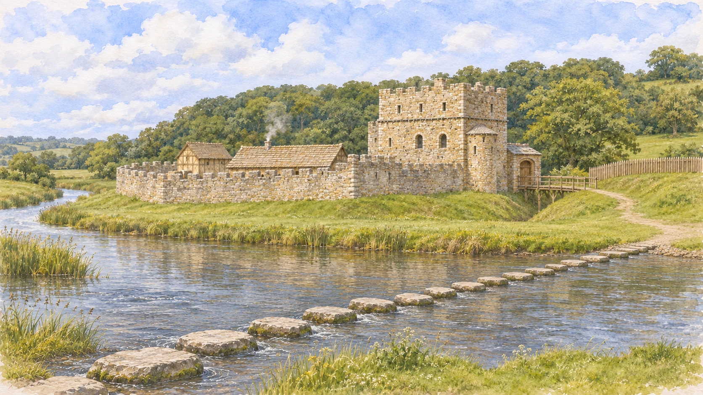

# Ogmore Castle in its developed medieval form

Prepared 6 November 2026 for the owner's request for a focused reconstruction using real photographs and historical descriptions. Updated 7 November: V3 adds the stepping-stone crossing and is now the selected illustration in the application's medieval-castle chapters. See the [crossing evidence and complete artwork audit](stepping-stones-evidence.md); its medieval date is probable, not an established construction year.

The owner's later request on 7 November adds an [imagined revolt-aftermath companion](revolt-aftermath-notes.md) for **The valley is caught in revolt.** That chapter now has its own damaged image; the two earlier medieval chapters retain intact V3. The damage pattern is explicitly speculative, and both paintings preserve the river crossing.

**Caption:** AI generated - estimated Ogmore Castle and crossing, approximately 1250-1300. Lost roofs, parapets, upper rooms and the medieval crossing arrangement are estimated.

## Owner correction: entrance and crossing viewpoint

The owner liked the first painting but identified that the entrance was on the wrong side of the keep. V1 is retained as generation history, **not as the approved or geometrically reliable reconstruction**. Its earlier visual check did not catch that error.

The owner supplied three modern photographs: a close view along the entrance bridge, a wider entrance view and a distant view across the river from the stepping-stones side. The first two establish the keep to the left of the entrance when approaching over the bridge; the third is the composition reference. V2 re-renders the castle from that side with a lower viewpoint, keeping the river in front, the inner circuit extending left of the keep and the entrance/ditch bridge and outer bailey to its right. The bridge crosses the castle ditch, not the river. The change is a re-composition using photographs, not a simple horizontal flip of v1.

These are still approximate visual relationships, not a surveyed camera match. The lower camera elevation is an interpretation of a visitor's view from the crossing; the supplied distant photograph is more elevated. The period and uncertainties below continue to apply. The owner requested integration of V2 on 6 November; the app then used its WebP in all three medieval-castle chapters, with a visible AI-generated/estimated-period label and matching alt description. V3 now replaces that shared image while preserving this orientation. Every other History image is also explicitly labelled AI generated. The earlier standalone design previews remain archived snapshots.

## Period and approach

Here, "in its prime" means the developed thirteenth-century stone castle after its early curtain-wall works and the heightening of the keep. It does not identify a documented year when every building had exactly this appearance. The working date avoids mixing the original timber stronghold with the later surviving courthouse. Layout is informed by the official ground plan and surviving ruins; the image is not a measured architectural model or a certified archaeological reconstruction.

## Written evidence and visual decisions

| Feature | Evidence and treatment | Confidence |
| --- | --- | --- |
| Keep | Cadw GM037 describes a roughly 14 by 10 m rectangular tower, subsequently heightened; the listed-building record identifies three storeys, local limestone and Sutton stone dressings. Restore one substantial rectangular keep with a small attached stair/garderobe projection. | Strong for footprint, storeys and materials; completed silhouette estimated. |
| Curtain and gateway | GM037 describes a faceted circuit and a simple entrance beside the keep. The listed record identifies early thirteenth-century gateway/bridge work. Keep the enclosure compact, without large round flanking towers. | Strong for position and general character; lost wall tops estimated. |
| Bridge | Bridge abutments survive. The official guide discusses a possible drawbridge pit; its interpretation of the western abutment is cautious. Show a short timber crossing over the ditch, with no claim to recover the exact mechanism. | Strong for location; timber form and mechanism uncertain. |
| River and earthworks | The guide's plan and the aerial photo fix the relative positions of the river, wards and ditch. Cadw describes tidal water entering the defences. Show deep cuts with limited shallow water, not a permanent ornamental lake. | Strong for broad arrangement; medieval bank shape and water state estimated. |
| Outer bailey | The guide describes an earth bank that was not replaced by a stone curtain and refers to palisades. Use an earth-and-timber enclosure. | Strong for defence type; exact palisade height, gate and extent estimated. |
| Hall | GM037 locates an approximately 21 by 7 m hall along the northern side. The guide suggests an upper hall; later published reconstruction commentary favours a lower building. Use a restrained roof mass and do not claim its lost elevation is resolved. | Strong for footprint; storey arrangement and roof uncertain. |
| Cellar building | GM037 records the late twelfth-century basement, approximately 9.5 by 7.5 m, and suggests a possible timber superstructure. Show a modest roofed timber upper portion above stone. | Strong for basement; function, upper rooms, framing and roof speculative. |
| Kitchen/service shelter | The guide proposes a kitchen between hall and keep but states the remains are uncertain. The small roof in this area is an interpretive suggestion. | Low. |
| Excluded later features | The courthouse has a complicated later history; the guide and newer records do not date every alteration alike. GM037 also places the southern range in a later period, whereas the older guide gives an earlier interpretation. Omit these disputed/later structures for this conservative thirteenth-century view. | Deliberate chronological restraint; omission does not prove the ground was empty. |
| Stones and surroundings | Cadw GM184 gives a probable medieval date with later revisions, without a founding year. V3 shows a plausible row across the Ewenny, guided by the owner's modern photograph; the medieval count and arrangement remain unknown. Trees, paths, vegetation and weather are scene-setting estimates. | Probable medieval origin; low for exact medieval appearance. |

## Sources consulted

1. [Cadw scheduled monument GM037](https://cadwpublic-api.azurewebsites.net/reports/sam/FullReport?id=2234&lang=en) - principal dimensional, layout and phasing description.
2. [Cadw listed-building record 21793](https://cadwpublic-api.azurewebsites.net/reports/listedbuilding/FullReport?id=21793) - surviving keep, materials, openings, stair/garderobe annexe and bridge details.
3. [Coflein NPRN 93019](https://coflein.gov.uk/en/sites/93019) - independent record summary of the keep's heightening, building positions and bibliography. Its cited 1991 inventory was not separately obtained in full for this image.
4. C. A. Ralegh Radford, *Ogmore Castle*, official Department of the Environment/Welsh Office guide, reprinted 1974: [public scan](https://www.peoplescollection.wales/sites/default/files/chs02965OgmoreCastlehistory1974_0.pdf). Read the existing local copy, including the ground plan on PDF page 6 and descriptions on printed pages 3-8. The web reader could not reopen the scan this turn; the local copy from the earlier research was used. Treat this older interpretation alongside the newer statutory records.
5. [Cadw visitor history](https://cadw.gov.wales/visit/places-to-visit/ogmore-castle) - broad development and tidal-ditch context.
6. [Visit the Vale Castle Trail](https://visitthevale.com/inspiration/castle-trail) - present-day aerial photograph, [original image URL](https://assets-global.website-files.com/602452bf511ad639c3e8aab6/65cb7cca0f38c36de0589f13_DJI_0062-scaled-p-2000.jpg). Used to check surviving footprint and landscape relationships, not to date features.
7. [UK Southwest: keep photograph](https://www.uksouthwest.net/vale-of-glamorgan/ogmore-castle/ogmore-castle-keep.html) - [image](https://www.uksouthwest.net/p1080/ogmore-castle-keep.jpg), showing the interior face of the surviving wall. Do not mistake the exposed interior fireplace for an exterior decoration.
8. [Medieval Heritage architectural study](https://medievalheritage.eu/en/main-page/heritage/wales/ogmore-castle/) - secondary cross-check and pointers to published reconstructions. Its drawings were not used as generation inputs or copied. Structural decisions above prefer the statutory records and observed plan.

## Generation provenance

Generated with the **built-in image_gen tool** on 6–7 November 2026. The first prompt is saved in [image-prompt.md](image-prompt.md); the entrance correction is in [image-prompt-v2.md](image-prompt-v2.md), and the crossing edit in [image-prompt-v3.md](image-prompt-v3.md). There are now three generations, one per version. Code performed delivery format conversion only. The V3 inputs, original output and saved master/WebP sizes are recorded in [stepping-stones-evidence.md](stepping-stones-evidence.md).

Reference input order:

1. `official-1974-plan.png`: page 6 of the existing official-guide PDF, rendered with Poppler at 1800 px; primary layout reference. Its historical compass is rotated relative to the aerial photograph.
2. `visit-the-vale-aerial.jpg`: original aerial photo, primary surviving-footprint reference.
3. `keep-standing-wall.jpg`: UK Southwest photo, masonry and surviving-wall reference; interior face.
4. Existing project `../assets/stone-castle.webp`: colour/medium reference only. Its earlier speculative architecture was explicitly not treated as evidence.

Downloaded third-party photographs and the rendered guide page remain outside the repository in the parent workspace's `designs/castle-reconstruction-2026-11-06/references/`. They are research inputs, not licensed website assets; they are not included in this deliverable folder. Source URLs are preserved above. The original guide remains in the earlier local research folder, also outside the repository.

Original generated master: `C:/Users/Steve/.codex/generated_images/01a16050-7f8e-70c3-aa0d-c3515dffc865/exec-429efd3e-8512-4c7b-bc96-f07e5182ffdd.png`.

Saved deliverables:

- `ogmore-castle-c1250-1300-v1.png`: unchanged 1672 by 941 RGB master, 3,775,802 bytes.
- `ogmore-castle-c1250-1300-v1.webp`: same dimensions, WebP quality 90, 644,408 bytes. Delivery compression only.
- `ogmore-castle-stepping-stones-view-v2.png`: unchanged 1672 by 941 RGB master, 3,562,107 bytes.
- `ogmore-castle-stepping-stones-view-v2.webp`: same dimensions, WebP quality 90, 594,080 bytes. Delivery compression only.

V2 original generated master: `C:/Users/Steve/.codex/generated_images/01a16050-7f8e-70c3-aa0d-c3515dffc865/exec-d6a74b68-e39a-4ff9-aa3b-5dfe492d9788.png`.

V2 reference inputs, in order:

1. `user-03-stepping-stones-view.png` - owner-provided distant view; primary composition and direction reference.
2. `user-01-entrance-close.png` - owner-provided close entrance photograph; keep/gateway relationship.
3. `user-02-entrance-wide.png` - owner-provided wider entrance photograph; supporting relationship and massing.
4. V1 generated PNG - medium, palette and painterly detail only; not positional evidence.

The three owner-supplied originals were copied unchanged from their chat attachment paths into the parent workspace's `designs/castle-reconstruction-2026-11-06/references/` with those filenames. They are preserved outside the repository, separate from the generated deliverables. Photographer/date/licensing are not established by the attachments; no claim is made that these are licensed website assets.

## Review result and next decision

V2 visual inspection confirms river foreground, leftward inner enclosure, rightward gateway/ditch bridge and outer bailey, restored rectangular keep and preserved watercolour treatment. The original v1 inspection was superseded by the owner's entrance correction above. Generated curves, relative dimensions and small architectural details remain approximate. Roof coverings, battlements, shutters, bridge rails and service roofs are visual hypotheses, not discoveries. Exterior lime finishes also remain unresolved; the exposed-stone treatment follows the project's palette rather than proving medieval surfaces were bare.

At the 6 November checkpoint the app import used V2. All 51 tests, TypeScript and production build passed. Browser checks confirmed that image loaded, all twelve slides had visible AI-generated captions and matching alt descriptions, and the caption fitted at 320px without horizontal overflow. The owner authorised committing and pushing that update; GitHub Pages deploys from main.

On 7 November the owner requested researching the stones' date and correcting the relevant artwork, with commit/push authorised. V3 retains V2's approved geometry and adds the river crossing. It replaces the active import in all three medieval-castle chapters, with estimated-crossing captions, qualified period notes and GM184 source links. All four later castle chapters already depict stones. The full evidence and scope decisions are in [stepping-stones-evidence.md](stepping-stones-evidence.md); V2 remains unchanged as the preceding version.
