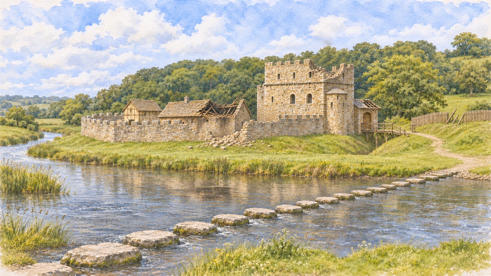

# Ogmore Castle: imagined aftermath of the revolt

Prepared 7 November 2026 for the owner's request to show a damaged version of the current painting in **The valley is caught in revolt.** Only that chapter uses this new companion; the two earlier stone-castle chapters retain intact V3.

## Evidence and interpretation

[Coflein NPRN 414237, Ogmore Castle Fulling Mill](https://coflein.gov.uk/en/sites/414237), rechecked on 7 November, records serious castle damage in **1402–05** during the Glyndŵr revolt and mentions fifteenth-century repairs. It cites the 1991 Glamorgan Inventory; that volume was not newly obtained for this edit. [Heneb's Ogmore landscape record](https://heneb.org.uk/hcla/merthyr-mawr-kenfig-and-margam-burrows/ogmore/) also describes the settlement's contraction after the rebellion.

These records support depicting a damaged castle, but do not establish which walls or roofs failed, an exact attack date, a particular siege method or what a visitor would have seen. The partly collapsed roof, damaged parapet, wall breach, debris and broken timber are **artistic hypotheses**. This is a repairable medieval castle after damage, rather than a backdating of today's ruins. The earlier reconstruction also remains an approximation of lost architecture and the medieval crossing, not a measured model.

The visible caption and image alt say **AI generated · imagined castle damage, 1402–05**. The chapter's expanded date note explains the speculative damage and uncertain medieval crossing. There is no battle, fire, army or invented named incident. The entrance remains on the approved side of the keep, the bridge crosses the castle ditch, and the complete stepping-stone row remains in the river foreground.

## Generation and delivery

- Tool: **built-in image_gen**, one targeted edit; sole input is the approved `ogmore-castle-stepping-stones-view-v3.webp`, inspected before editing.
- Original output: `C:/Users/Steve/.codex/generated_images/01a16050-7f8e-70c3-aa0d-c3515dffc865/exec-2aa0c22a-c838-417e-9674-6a030c3f7551.png`.
- Saved master: `ogmore-castle-revolt-aftermath-v1.png`, copied unchanged into this folder, 1671 × 941 RGB, 3,126,622 bytes.
- Website image: `ogmore-castle-revolt-aftermath-v1.webp`, same dimensions, quality 90, 480,450 bytes. Pillow performed delivery compression only, with no compositing or repainting.
- Archive-builder preview: `../assets/damaged-castle.webp`, 1024 × 577, quality 80, 147,050 bytes. Delivery resizing/compression only; this keeps the existing inline preview builder below its 1 MB limit. An isolated build produced 899,483 bytes with twelve milestones and six paintings; the previously archived preview exports were not overwritten.
- Original V3 and earlier generations remain unchanged. The earlier self-contained design previews remain archived snapshots.

## Integration checks

The application uses the 480 KB website WebP only for `revolt`; the earlier `stone` and `lancaster` chapters still use intact V3. Explicit image dimensions match the returned 1671 × 941 master. All nine existing History timeline/loader checks, TypeScript and the production build pass. Browser review at default width, 1280 × 720 and 320 × 568 confirms the damaged keep/roof and crossing remain visible, captions and expanded uncertainty notes fit, and all twelve dates/AI labels remain available. No dependency or landing-page change. The viewport was reset and the local revolt chapter retained for inspection.

## Exact generation prompt

```text
Use case: precise-object-edit.
Asset type: a new companion watercolour for the History chapter "The valley is caught in revolt.", dated 1402–05.
Primary request: Make a clearly damaged version of the supplied approved Ogmore Castle painting. This is the imagined quiet aftermath of the serious damage recorded during the Glyndwr revolt, not a battle scene. Preserve the recognisable castle, entrance side, river viewpoint, stepping stones and luminous watercolour style.

INPUT:
Image 1 is the EDIT TARGET and sole visual reference: ogmore-castle-stepping-stones-view-v3.webp, our approved intact reconstruction. Derive this companion directly from that painting. Do not redesign or mirror the castle.

HISTORICAL CONSTRAINT:
Coflein NPRN 414237 records that Ogmore Castle was badly damaged in 1402–05 and refers to later fifteenth-century repairs. It does not establish a surveyed pattern of destruction, particular breaches or burned roofs. Treat the following visual damage as a restrained artist's interpretation, not a documented reconstruction of a specific attack. The castle should remain substantially standing and potentially repairable, rather than becoming today's much later ruins.

TARGETED CHANGES:
Show obvious, legible damage to the existing buildings, visible even at small website size. Leave the main rectangular keep largely standing, retaining its broad three-storey mass, lower storeys, existing window positions and small attached annexe, but break a limited portion of its upper parapet/corner into a rough, recently damaged silhouette with several missing battlements and exposed broken masonry. Give the main hall roof immediately left of the keep a substantial local collapse, showing a few broken dark roof timbers and missing tiles, with a little subdued soot on adjacent masonry. Damage a short section of the existing low curtain wall, scattering a modest amount of limestone rubble at its foot. Some gateway roof timbers and the short ditch bridge's handrail may be broken, while their original positions and relationship to the keep remain clear. Add a few damaged or leaning palisade stakes in the existing outer bailey on the right. Keep damage concentrated on the actual castle structures; do not fill the scene with arbitrary debris.
The broken keep top and damaged hall roof should communicate the aftermath clearly in the central/right building group, even when the website's caption covers the lower-left part of the picture.

PRESERVE THESE INVARIANTS:
Keep the same wide 16:9 framing, camera height and angle, castle footprint and relative building positions. Preserve the inner curtain enclosure extending left from the keep, the separate entrance and short bridge over the castle ditch to its right, and the outer bailey on the right. Do not relocate the entrance, add towers or invent modern courthouse ruins. Keep the river as the broad foreground with its bend to the left.
Preserve the complete, clearly visible diagonal stepping-stone crossing through the foreground Ewenny exactly as in the edit target: same individual stones, positions, natural flat tread tops, gaps, perspective, near-bank entry and right-side far-bank landing. Do not break, remove, submerge or obscure this crossing. Preserve the grass banks, trees, wooded hillside, daylight, pale blue/clouded sky, water level and reflections except immediately where damaged buildings would change a reflection.
Match the finely observed translucent watercolour, olive/sage foliage, warm grey limestone, blue-grey water, ivory cold-pressed paper grain and painterly detail. Maintain the same overall daylight palette rather than applying a gloomy filter. The damage should read through physical changes to the structures.

AVOID:
No active flames, smoke plumes, armies, fighting, injured people, bodies, flags, siege engines, modern objects, modern ruins, fantasy architecture, exaggerated total collapse, changes to the stepping stones, labels, text, dates, logos, watermark, border, comparison panels or collage. Output one finished painting.
```


