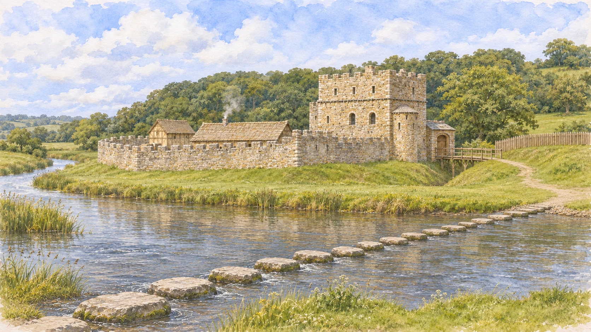

# When did the stepping stones appear?

Researched and artwork reviewed on 7 November 2026, following the owner's request to include the crossing in the castle-at-its-peak painting and later relevant scenes.

## What the evidence establishes

The strongest dating evidence located is [Cadw's scheduled-monument record GM184](https://cadwpublic-api.azurewebsites.net/reports/sam/FullReport?id=2875). It classifies the crossing as medieval and describes it as **probably medieval in date with later revisions**. It gives neither a construction year nor a named builder. The present structure cannot establish the exact medieval stone count or arrangement.

The record places the crossing across the Ewenny, linking the castle's south bank to the floodplain between the Ewenny and Ogmore. It describes a deliberate alignment across a wider, shallower, slower-flowing stretch. The current recorded alignment is north–south, approximately 35 metres, with 41 stones. These describe the recorded monument, not a recovered thirteenth-century plan. Other modern stone counts and founding stories do not resolve its original date.

[Cadw's castle visitor history](https://cadw.gov.wales/visit/places-to-visit/ogmore-castle) also associates the castle with an ancient stepping-stone crossing, but does not date the stones. Its early-thirteenth-century date concerns the castle's curtain wall, not construction of the crossing.

An [archival aerial photograph from 1950, WAW033689](https://britainfromabove.org.uk/en/image/WAW033689), is independently catalogued as showing the castle and stepping stones. This is later visual evidence, not proof of a medieval founding year. The photograph is linked, not reproduced or used as a generation input.

## Decision for the illustrations

Showing a crossing beside the developed c.1250–1300 castle is a **plausible artistic interpretation of the probable medieval dating**, not a finding that the stones were built by 1250. There is no defensible exact year at which to switch them on in a factual timeline. The chosen boundary is an illustration convention, and the captions and period notes make this clear.

V3 therefore adds separate flat-topped limestone stones spanning the foreground river. It preserves the approved V2 castle, entrance side, ditch bridge, viewpoint and watercolour treatment. The modern owner-supplied river photograph guides only the broad relationship between crossing and castle-side bank. The reconstructed row is not a surveyed placement or an attempt to reproduce today's exact count. The castle's defensive ditch remains separate from the river crossing.

The earliest timber-fort illustration is retained with an explicit note that the stones cannot be assigned specifically to that phase; their omission is not evidence of absence. Priory and dune paintings show different places and do not acquire an invented castle-side crossing. Archived/rejected generations and self-contained design previews remain unchanged as provenance, rather than silently rewriting previous review material.

## Complete live History artwork audit

| Chapters | Active painting | Crossing treatment |
| --- | --- | --- |
| Before 1100; 1806–09; 2020–23 | `assets/dunes.webp` | Wider dune landscape, not this river crossing; unchanged. |
| Early 1100s | `assets/early-fort.webp` | Earth-and-timber interpretation; stones not securely datable to this phase. Date note explains uncertainty. |
| 1141 | `assets/priory.webp` | Ewenni Priory, not the castle crossing; unchanged. |
| Early 1200s; late 1200s | `reconstruction/ogmore-castle-stepping-stones-view-v3.webp` | Shared c.1250–1300 reconstruction with a visible plausible medieval row; AI/estimated caption and Cadw link in both chapters. |
| 1402–05 | `reconstruction/ogmore-castle-revolt-aftermath-v1.webp` | [Imagined damage companion](revolt-aftermath-notes.md), edited from intact V3 at the owner's subsequent request. The crossing remains clearly visible; caption/date note distinguish artistic damage from recorded history. |
| 1500s–1600s; 1803; 1928; Today | `assets/present-castle.webp` | All four already show a complete crossing in the existing present-day-inspired castle study; unchanged, retaining its AI label. It is not claimed as the exact historical appearance for those milestone years. |

The application initially used V3 for all three medieval-castle chapters. The owner's subsequent revolt-scene request gives 1402–05 its own damaged companion while retaining intact V3 for the earlier two. Both paintings show the crossing. All twelve History chapters continue to identify their illustrations as AI generated.

## Generation and saved files

- Tool: built-in `image_gen`, one targeted edit on 7 November 2026.
- Exact prompt and ordered reference roles: [image-prompt-v3.md](image-prompt-v3.md).
- Edit target: unchanged V2 WebP in this folder.
- Geographic reference: owner-supplied `user-03-stepping-stones-view.png`, retained outside the repository under the parent workspace's `designs/castle-reconstruction-2026-11-06/references/`. It is not redistributed as a website asset.
- Original output: `C:/Users/Steve/.codex/generated_images/01a16050-7f8e-70c3-aa0d-c3515dffc865/exec-f9cfcb57-5c9a-4d85-8b8f-9fdfa3c0fb53.png`.
- Saved unchanged PNG master: `ogmore-castle-stepping-stones-view-v3.png`, 1672 × 941 RGB, 3,244,609 bytes.
- Website delivery file: `ogmore-castle-stepping-stones-view-v3.webp`, same dimensions, quality 90, 518,912 bytes. Pillow performed format conversion only, without compositing, repainting or resizing.
- V1/V2 images and prompts remain preserved as earlier generations.

